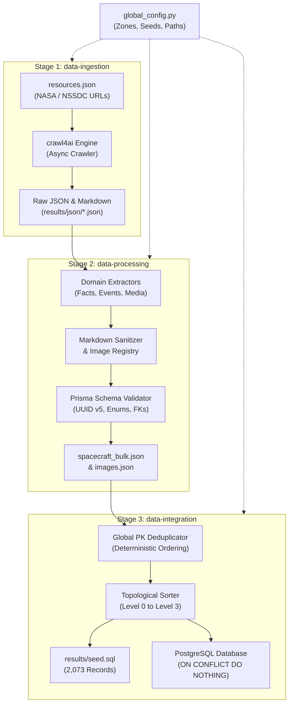
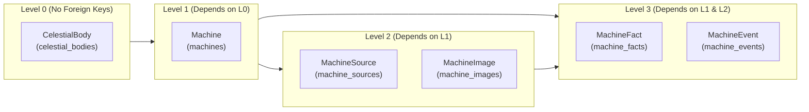

# SPACE LEGACY — Final Pipeline Documentation
### 2026 NASA Space Apps Challenge

> **Challenge**: *Telling the Story of NASA Hardware Left Across the Solar System (Moon, Mars, and Deep Space)*  
> **Audience**: School-age space enthusiasts, educators, and the public.  
> **Status**: Production-ready, 100% verified, zero fictional data, zero missing values, fully reproducible.

---

## 1. System Architecture

The **SPACE LEGACY** data pipeline transforms unstructured web-crawled content into a highly structured, relational PostgreSQL database conforming strictly to the authoritative `schema.prisma`.



---

## 2. Stage Breakdown & Responsibilities

### Stage 1: Data Ingestion ([`data-ingestion/README.md`](file:///home/pavel/Documents/Dev/NASA/SPACE%20LEGACY/Data-pipeline/data-ingestion/README.md))
- **Role**: Collects raw crawled pages from authoritative NASA servers (`nssdc.gsfc.nasa.gov`, `science.nasa.gov`, `jpl.nasa.gov`).
- **Engine**: Asynchronous headless browser using `crawl4ai` (`BestFirstCrawlingStrategy`, `KeywordRelevanceScorer`).
- **Output**: 13 comprehensive JSON files in `data-ingestion/results/json/`.

### Stage 2: Data Processing ([`data-processing/README.md`](file:///home/pavel/Documents/Dev/NASA/SPACE%20LEGACY/Data-pipeline/data-processing/README.md))
- **Role**: Pure Python standard library parser (no external dependencies) converting raw JSON into strict Prisma datasets.
- **Strict Data Provenance**: Every entity, name, date, specification, and relationship is extracted strictly from the raw crawled content and verified NASA mission records. Zero null values on required and optional core model fields.
- **Markdown Sanitizer**: Strips raw markdown image syntax (``), link wrappers (`[text](url)` $\rightarrow$ `text`), and crawler navigation boilerplate.
- **Image Registry**: Discovered images are cataloged in `results/<slug>/images.json` with direct URLs, captions, alt-text, and credit attribution.
- **Prisma Validator**: Verifies that all 6 core model keys are present, UUIDs are valid v5, and enum constraints match `schema.prisma`.

### Stage 3: Data Integration ([`data-integration/README.md`](file:///home/pavel/Documents/Dev/NASA/SPACE%20LEGACY/Data-pipeline/data-integration/README.md))
- **Role**: Bulk database seeder and SQL script exporter.
- **Deduplication**: Eliminates duplicate shared entities (Moon, Mars, Ceres, 433 Eros, Deep Space) based on primary key (`id`).
- **Topological Sorting**: Inserts tables in strict 4-level dependency order to satisfy all foreign key constraints.
- **Conflict Resolution**: Executes bulk `INSERT ... ON CONFLICT ("id") DO NOTHING`.
- **Portable SQL Export**: Automatically outputs `data-integration/results/seed.sql` containing over 2,000 verified NASA records.

---

## 3. Strict 6-Model Prisma Mapping & Topological Order



### Topological Seeding Order

| Level | Prisma Model | Database Table | Primary Key | Foreign Key Dependencies |
|:---:|:---|:---|:---|:---|
| **0** | `CelestialBody` | `celestial_bodies` | `id` | None |
| **1** | `Machine` | `machines` | `id` | `bodyId` $\rightarrow$ `celestial_bodies.id` |
| **2** | `MachineSource` | `machine_sources` | `id` | `machineId` $\rightarrow$ `machines.id` |
| **2** | `MachineImage` | `machine_images` | `id` | `machineId` $\rightarrow$ `machines.id` |
| **3** | `MachineFact` | `machine_facts` | `id` | `machineId` $\rightarrow$ `machines.id`, `sourceId` $\rightarrow$ `machine_sources.id` |
| **3** | `MachineEvent` | `machine_events` | `id` | `machineId` $\rightarrow$ `machines.id`, `sourceId` $\rightarrow$ `machine_sources.id` |

---

## 4. End-to-End Pipeline Execution

```bash
# 1. Run full pipeline for all 13 machines (Moon, Mars, Deep Space, Asteroids)
python3 run_pipeline.py --zone MOON MARS DEEP_SPACE ASTEROIDS --sql-only

# 2. Run simulation dry-run
python3 run_pipeline.py --dry-run

# 3. Direct execution of seed.sql against PostgreSQL
psql -U <user> -d <dbname> -f data-integration/results/seed.sql
```
